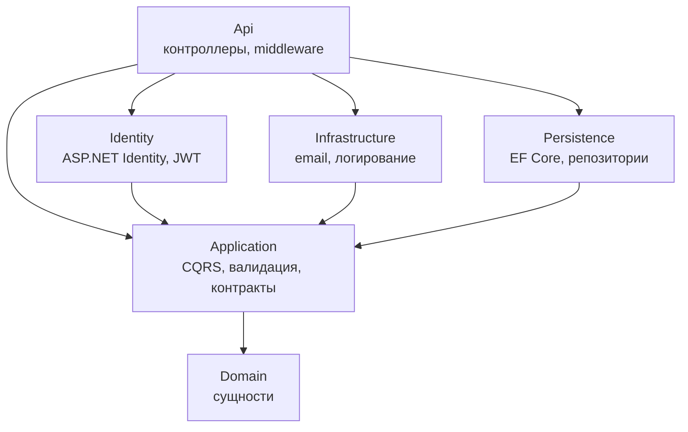

# RestApi

REST API для каталога товаров на **ASP.NET Core 8**: Clean Architecture, CQRS через MediatR, JWT-аутентификация и подтверждение регистрации по email.


## Содержание

- [О проекте](#о-проекте)
- [Возможности](#возможности)
- [Технологии](#технологии)
- [Архитектура](#архитектура)
- [Структура проекта](#структура-проекта)
- [API](#api)
- [Примеры запросов](#примеры-запросов)
- [Обработка ошибок](#обработка-ошибок)
- [Запуск локально](#запуск-локально)
- [Конфигурация](#конфигурация)
- [Логирование](#логирование)

## О проекте

Backend для управления каталогом товаров и категорий. Пользователь регистрируется, подтверждает почту, получает JWT и с ним работает с защищёнными эндпоинтами.

Проект учебный. На нём я разбирался, как строить поддерживаемый backend на .NET: как разделить код на слои с однонаправленными зависимостями, отделить команды от запросов, вынести валидацию и обработку ошибок из контроллеров и выстроить аутентификацию на ASP.NET Core Identity.

## Возможности

- **CRUD категорий.** Каждая операция — отдельная команда или запрос MediatR со своим обработчиком.
- **Регистрация с подтверждением email.** Токен подтверждения с ограниченным сроком жизни уходит на почту по SMTP. Войти можно только после подтверждения.
- **JWT-аутентификация.** Токен подписывается HMAC-SHA256 и содержит claims `sub`, `email`, `uid` и роли пользователя. Срок жизни, issuer и audience проверяются.
- **Роли ASP.NET Core Identity.** Роль `User` создаётся seed-данными и назначается при регистрации.
- **Валидация на FluentValidation.** Общие правила вынесены в `BaseCategoryCommandValidator` и подключаются через `Include`. Уникальность имени проверяется асинхронно через репозиторий.
- **Глобальная обработка ошибок.** `ExceptionMiddleware` превращает исключения в ответы формата ProblemDetails с нужным HTTP-кодом и списком ошибок валидации.
- **Структурированное логирование.** Serilog пишет в консоль и в файл с ротацией по дням и логирует HTTP-запросы. Слой Application пишет логи через собственную абстракцию `IAppLogger<T>`.
- **Аудит изменений.** `CreatedDate` и `ModifiedDate` проставляются автоматически в переопределённом `SaveChangesAsync`.
- **Доступ к данным.** Generic Repository, Fluent API конфигурации сущностей, миграции EF Core и seed-данные.

## Технологии

| Категория | Технологии |
|---|---|
| Платформа | .NET 8, ASP.NET Core Web API, C# 12 |
| Данные | Entity Framework Core 8, SQL Server (LocalDB) |
| Аутентификация | ASP.NET Core Identity, JWT Bearer |
| Архитектура и паттерны | Clean Architecture, CQRS, Mediator (MediatR 12), Repository, Options pattern |
| Валидация | FluentValidation 11 |
| Маппинг | AutoMapper 12 |
| Логирование | Serilog 3 (Console, File) |
| Документация API | Swagger (Swashbuckle 6) |

## Архитектура

Решение разделено на шесть проектов по принципам Clean Architecture. Зависимости направлены внутрь, к доменной модели. Слой `Application` объявляет интерфейсы (`ICategoryRepository`, `IEmailSender`, `IAuthService`, `IAppLogger<T>`), а внешние слои их реализуют. Бизнес-логика не знает ни про EF Core, ни про SMTP.



| Проект | Ответственность |
|---|---|
| **Domain** | Сущности `Category`, `Product` и базовый класс `BaseEntity` с полями аудита |
| **Application** | Команды и запросы MediatR, их обработчики, валидаторы, профили AutoMapper, DTO и интерфейсы для внешних слоёв |
| **Persistence** | `ProductDatabaseContext`, конфигурации сущностей, миграции, реализации репозиториев |
| **Identity** | `IdentityDbContext`, `AuthService`, `UserService`, настройка JWT, seed-данные пользователя и роли |
| **Infrastructure** | Отправка email по SMTP, адаптер логгера |
| **Api** | Контроллеры, `ExceptionMiddleware`, сборка DI-контейнера, Serilog, Swagger |

Каждый слой регистрирует свои зависимости через метод расширения (`AddApplicationServices`, `AddPersistenceServices`, `AddIdentityServices`, `AddInfrastructureServices`), поэтому `Program.cs` остаётся коротким.

Данные лежат в двух базах: каталог в `ProductsDB` (`ProductDatabaseContext`), пользователи и роли в `ProductIdentity` (`IdentityDbContext`).

**Путь запроса** на примере `PUT /api/categories`:

1. `CategoriesController` принимает `UpdateCategoryCommand` и передаёт её в `IMediator.Send`. Бизнес-логики в контроллере нет.
2. `UpdateCategoryCommandHandler` загружает категорию через `ICategoryRepository`. Если её нет, выбрасывает `NotFoundException`.
3. `UpdateCategoryCommandValidator` проверяет данные и уникальность имени. При ошибке выбрасывается `BadRequestException` со списком ошибок.
4. AutoMapper переносит данные из команды в сущность. Репозиторий сохраняет её, а `SaveChangesAsync` обновляет `ModifiedDate`.
5. Если на любом шаге возникло исключение, `ExceptionMiddleware` возвращает ProblemDetails с соответствующим HTTP-кодом.

## Структура проекта

```
RestApi/
├── Domain/                     # Сущности: BaseEntity, Category, Product
├── Application/                # Бизнес-логика, не зависит от инфраструктуры
│   ├── Contracts/              # Интерфейсы: репозитории, email, логгер, auth
│   ├── Exceptions/             # BadRequestException, NotFoundException
│   ├── Features/
│   │   └── Category/
│   │       ├── Commands/       # Create / Update / Delete + валидаторы
│   │       ├── Queries/        # GetAllCategories / GetCategoryDetails
│   │       └── Shared/         # Базовая команда и общий валидатор
│   ├── MappingProfiles/        # Профили AutoMapper
│   └── Models/                 # DTO для Identity и Email, классы настроек
├── Persistence/                # DbContext, конфигурации, миграции, репозитории
├── Identity/                   # Identity DbContext, AuthService, seed, миграции
├── Infrastructure/             # EmailSender (SMTP), LoggerAdapter
└── Api/                        # Контроллеры, ExceptionMiddleware, Program.cs
```

## API

| Метод | Endpoint | Доступ | Описание | Ответы |
|---|---|---|---|---|
| `POST` | `/api/auth/register` | Все | Регистрация и отправка токена подтверждения на email | 200, 400 |
| `POST` | `/api/auth/confirmRegistration` | Все | Подтверждение email по токену из письма | 200, 400, 404 |
| `POST` | `/api/auth/login` | Все | Вход, выдача JWT | 200, 400, 404 |
| `GET` | `/api/categories` | JWT | Список категорий | 200, 401 |
| `GET` | `/api/categories/{id}` | JWT | Категория с датами создания и изменения | 200, 401, 404 |
| `POST` | `/api/categories` | JWT | Создание категории | 201, 400, 401 |
| `PUT` | `/api/categories` | JWT | Обновление категории (`id` передаётся в теле) | 204, 400, 401, 404 |
| `DELETE` | `/api/categories/{id}` | JWT | Удаление категории | 204, 401, 404 |

**Правила валидации категории:** `name` обязателен, не длиннее 50 символов и уникален. `description` не длиннее 100 символов.

**Как устроена регистрация:**

1. `register` создаёт пользователя с неподтверждённой почтой и отправляет ему письмо с токеном. Срок жизни токена задаёт `JwtSettings:DurationInMinutes`.
2. `confirmRegistration` находит пользователя по токену, проверяет, что токен не истёк, и подтверждает email.
3. `login` пускает только пользователей с подтверждённой почтой и возвращает JWT.
4. Если пользователь не подтвердил почту и токен истёк, при повторной регистрации на тот же email старый аккаунт удаляется.

Пароль должен соответствовать стандартной политике ASP.NET Core Identity: минимум 6 символов, цифра, строчная и заглавная буквы, спецсимвол.

## Примеры запросов

**Вход** под тестовым пользователем из seed-данных:

```bash
curl -X POST https://localhost:5001/api/auth/login \
  -H "Content-Type: application/json" \
  -d '{"email": "test@mail.ru", "password": "admin123"}'
```

```json
{
  "id": "8e445865-a24d-4543-a6c6-9443d048cdb9",
  "userName": "admin123",
  "email": "test@mail.ru",
  "token": "eyJhbGciOiJIUzI1NiIsInR5cCI6IkpXVCJ9..."
}
```

**Список категорий** с полученным токеном:

```bash
TOKEN="<token из ответа>"

curl https://localhost:5001/api/categories \
  -H "Authorization: Bearer $TOKEN"
```

```json
[
  { "id": 1, "name": "name1", "description": "description1" },
  { "id": 2, "name": "name2", "description": "description2" }
]
```

**Создание категории** возвращает `201 Created`:

```bash
curl -X POST https://localhost:5001/api/categories \
  -H "Authorization: Bearer $TOKEN" \
  -H "Content-Type: application/json" \
  -d '{"name": "Напитки", "description": "Соки, вода, газировка"}'
```

**Ошибка валидации.** Если имя длиннее 50 символов, ответ будет `400 Bad Request`:

```json
{
  "type": "BadRequestException",
  "title": "Invalid Category",
  "status": 400,
  "errors": {
    "Name": ["Name must be fewer than 50 characters"]
  }
}
```

## Обработка ошибок

Контроллеры не содержат `try/catch`. Исключения из слоя Application перехватывает `ExceptionMiddleware` и возвращает единый формат ответа (`CustomProblemDetails`, наследник `ProblemDetails`):

| Ситуация | HTTP-код | Тело ответа |
|---|---|---|
| `BadRequestException`: ошибка валидации или бизнес-правила | 400 | `title` и словарь `errors` |
| `NotFoundException`: сущность не найдена | 404 | `title` с названием сущности и ключом |
| JWT не передан или невалиден | 401 | Пустое тело и заголовок `WWW-Authenticate` |
| Любое другое исключение | 500 | Сообщение исключения |

## Запуск локально

**Что понадобится:**

- [.NET 8 SDK](https://dotnet.microsoft.com/download/dotnet/8.0)
- SQL Server LocalDB (ставится вместе с Visual Studio) или другой экземпляр SQL Server
- Инструмент EF Core CLI: `dotnet tool install --global dotnet-ef`

**1. Клонировать репозиторий**

```bash
git clone https://github.com/KonstantinUsikov/RestApi.git
cd RestApi
```

**2. Проверить строки подключения** в `Api/appsettings.json`. По умолчанию используется `(localdb)\MSSQLLocalDB`.

**3. Применить миграции.** У каждой из двух баз свой DbContext:

```bash
dotnet ef database update --project Persistence --startup-project Api --context ProductDatabaseContext
dotnet ef database update --project Identity --startup-project Api --context Identity.Context.IdentityDbContext
```

**4. Запустить API**

```bash
dotnet dev-certs https --trust   # один раз, чтобы доверять локальному HTTPS-сертификату
dotnet run --project Api --launch-profile https
```

API будет доступен на `https://localhost:5001`, Swagger UI — на `https://localhost:5001/swagger` (только в окружении Development).

**Тестовый пользователь** создаётся миграцией, его email уже подтверждён:

| Email | Пароль | Роль |
|---|---|---|
| `test@mail.ru` | `admin123` | `User` |

## Конфигурация

Все настройки лежат в `Api/appsettings.json` и читаются через Options pattern.

| Секция | Назначение |
|---|---|
| `ConnectionStrings:ProductDatabaseConnectionString` | База каталога (`ProductsDB`) |
| `ConnectionStrings:ProductIdentityConnectionString` | База пользователей (`ProductIdentity`) |
| `JwtSettings` | `Key` — ключ подписи (не короче 32 символов), `Issuer`, `Audience`, `DurationInMinutes` — время жизни токена |
| `EmailSettings` | SMTP-сервер, порт и учётные данные почтового ящика для отправки писем |
| `Serilog` | Уровни логирования и файловый sink |

Любое значение можно переопределить переменной окружения, не меняя файл. Вложенность секций обозначается двойным подчёркиванием:

```bash
# bash
export JwtSettings__Key="ваш-секретный-ключ-длиной-не-менее-32-символов"
export EmailSettings__FromMail="you@example.com"
export EmailSettings__FromPassword="пароль-приложения"
```

```powershell
# PowerShell
$env:JwtSettings__Key = "ваш-секретный-ключ-длиной-не-менее-32-символов"
```

## Логирование

Serilog настраивается в `Program.cs` и секции `Serilog` в `appsettings.json`:

- логи пишутся в консоль и в файл `logs/log-YYYYMMDD.txt` (относительно рабочей директории), новый файл создаётся каждый день;
- минимальный уровень — `Information`, а для `Microsoft.*` — `Warning`, чтобы не засорять вывод;
- `UseSerilogRequestLogging` пишет одну сводную строку на каждый HTTP-запрос: метод, путь, статус и время ответа.
